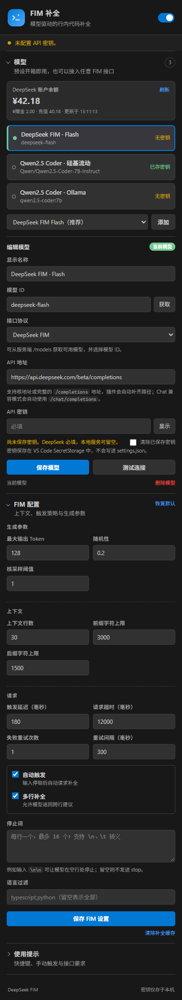

# DeepSeek FIM

为 VS Code 提供 **FIM（Fill-In-the-Middle）行内补全**。光标停在函数中间、参数列表里或空行上时，插件会把光标前后的代码作为 `prompt` / `suffix` 发送给模型，并把返回的中间片段作为 Inline Suggest 展示。

支持 DeepSeek 官方 FIM 接口，也支持任意 OpenAI 兼容的 `/completions` 服务。



## 功能

- **行内补全**：原生 `InlineCompletionItemProvider`，按 `Tab` 接受建议。
- **FIM 上下文**：自动提取前后文，按行数与字符数双重截断。
- **预设 + 自定义模型**：DeepSeek、硅基流动 Qwen Coder、Ollama 本地模型，或接入任意地址。
- **可折叠面板**：模型、FIM 配置、使用提示均可展开/收起，折叠状态会保留。
- **模型列表**：可以从服务端 `/models` 获取可用模型，并选择模型 ID。
- **Chat 兼容回退（实验性）**：对于只提供 `/chat/completions` 的服务，可以用 Chat 模式做行内补全。
- **可调参数**：最大输出 Token、上下文行数、前缀/后缀字符上限、触发延迟、随机性、核采样、停止词、超时、单/多行、语言过滤。
- **安全存储**：API 密钥保存在 VS Code `SecretStorage`，不会写入 `settings.json`，也不会回传到 Webview。
- **连接测试**：在面板内直接发送一条极小的 FIM 请求，查看延迟和返回片段。
- **状态栏**：显示就绪 / 缺少密钥 / 已暂停 / 最近错误，点击直接打开设置。
- **账户余额**：DeepSeek 模型可在面板查看账户余额，支持手动刷新，也可通过命令查询。
- **失败退避**：401/402/429/5xx、超时或网络错误后自动冷却，避免连续失败时反复请求。
- **失败重试**：对 429、5xx、超时和网络错误可按配置重试 0–2 次。
- **使用统计**：记录请求、成功/失败、重试、缓存命中、Token 和延迟，可从命令面板查看。
- **诊断报告**：一键生成 Markdown 报告，包含当前模型、请求地址、配置、统计和最近请求。
- **并发控制**：同一时间只保留一个补全请求，新请求会取消旧请求；取消和文档变化都会中止 HTTP 请求。
- **缓存与取消**：同版本同位置复用结果；编辑器取消或文档变化时立即中止请求。

## 安装

### 从 VSIX 安装

```bash
pnpm install
pnpm run package
code --install-extension deepseek-fim-0.2.3.vsix
```

安装后点击活动栏的 **FIM 补全** 图标，或执行命令 `DeepSeek FIM: 打开设置面板`。

### 开发调试

```bash
pnpm install
pnpm run watch
```

在 VS Code 中按 `F5`，会以 Extension Development Host 启动。

## 快速开始（DeepSeek）

1. 打开活动栏的 **FIM 补全**。
2. 在“模型”区域选择 `DeepSeek FIM Flash（推荐）`，点击“添加”。
3. 填写 **API 密钥**，点击“保存模型”。也可以执行命令 `DeepSeek FIM: 设置当前模型的 API 密钥`，用密码输入框写入。
4. 点击“测试连接”，确认返回了代码片段。
5. 打开任意代码文件，在函数中间停顿，等待建议出现；按 `Tab` 接受。
6. 也可以在命令面板执行 `DeepSeek FIM: 手动触发行内补全`。

DeepSeek 的预设地址为：

```text
https://api.deepseek.com/beta/completions
```

官方 FIM 当前支持 `deepseek-flash` 与 `deepseek-v4-pro`；插件默认使用 `deepseek-flash`，并提供 `DeepSeek FIM V4 Pro` 预设。FIM 单次补全上限为 4096 Token。密钥在 <https://platform.deepseek.com/api_keys> 创建。

接口文档：<https://api-docs.deepseek.com/zh-cn/guides/fim_completion>

## 模型配置

每个模型包含：

| 字段 | 说明 |
| --- | --- |
| 名称 | 面板内显示的名字 |
| 模型 ID | 请求体中的 `model`，例如 `deepseek-flash` |
| API 地址 | 根地址或完整 `/completions` 地址，插件会自动补全路径 |
| 接口协议 | `DeepSeek FIM`、`OpenAI 兼容 FIM` 或 `Chat 兼容（实验性）` |
| API 密钥 | 存于 SecretStorage；本地 Ollama 可留空 |

地址解析规则：

- 以 `/completions` 结尾：直接使用。
- DeepSeek 根地址：补成 `/beta/completions`。
- 以 `/v1`、`/v1beta`、`/beta` 结尾：补成 `.../completions`。
- 其他 OpenAI 兼容根地址：补成 `/v1/completions`。

## FIM 配置

| 设置 | 默认值 | 说明 |
| --- | --- | --- |
| `deepseek-fim.enabled` | `true` | 启用行内补全 |
| `deepseek-fim.autoTrigger` | `true` | 输入时自动触发；关闭后仍可手动触发 |
| `deepseek-fim.multiLine` | `true` | 是否接受跨行建议 |
| `deepseek-fim.debounceMs` | `180` | 输入触发延迟（毫秒） |
| `deepseek-fim.maxTokens` | `128` | 最大输出 Token 数，最大 4096（DeepSeek FIM 上限） |
| `deepseek-fim.contextLines` | `30` | 光标前后上下文行数 |
| `deepseek-fim.maxPrefixChars` | `3000` | 前缀字符上限 |
| `deepseek-fim.maxSuffixChars` | `1500` | 后缀字符上限 |
| `deepseek-fim.temperature` | `0.2` | 生成随机性；越低越稳定，越高越发散 |
| `deepseek-fim.topP` | `1` | 核采样阈值 `(0, 1]`；官方建议不要同时大幅修改随机性和核采样 |
| `deepseek-fim.stopSequences` | `[]` | 最多 16 个停止词；面板中每行一个，支持 `\n`、`\t` 转义 |
| `deepseek-fim.retryCount` | `1` | 429、5xx、超时、网络错误的最大重试次数（0–2） |
| `deepseek-fim.retryDelayMs` | `300` | 首次重试等待时间，后续按重试次数递增 |
| `deepseek-fim.requestTimeoutMs` | `12000` | 请求超时（毫秒） |
| `deepseek-fim.languages` | 空 | 仅在这些语言启用，逗号分隔；空表示全部 |

面板中的设置写入 VS Code 全局配置，也可以直接编辑 `settings.json`。

## 接口约定

插件发送：

```http
POST <API 地址>
Content-Type: application/json
Authorization: Bearer <API 密钥>

{
  "model": "deepseek-flash",
  "prompt": "<光标前的代码>",
  "suffix": "<光标后的代码>",
  "max_tokens": 128,
  "temperature": 0.2,
  "top_p": 1,
  "stop": ["\\n\\n"],
  "stream": false
}
```

期望响应：

```json
{
  "choices": [
    { "text": "return a + b;" }
  ]
}
```

同时兼容 `choices[0].message.content`。插件不会把 `prompt`、`suffix` 或密钥写入日志。

模型列表接口：

```http
GET https://api.deepseek.com/models
Authorization: Bearer <API 密钥>
```

在“模型 ID”输入框右侧点击“获取”，插件会读取模型 ID、展示名称、上下文窗口和输出上限，并通过 `datalist` 提供输入建议。

DeepSeek 余额查询使用：

```http
GET https://api.deepseek.com/user/balance
Authorization: Bearer <API 密钥>
```

返回 `is_available` 与 `balance_infos`（CNY / USD）；插件会在 DeepSeek 模型的面板中显示总余额、赠金和充值余额。

## Chat 兼容回退（实验性）

如果服务不支持 FIM 的 `prompt` + `suffix`，可以把模型接口协议切到 **Chat 兼容（实验性）**。插件会：

1. 自动把地址归一到 `/chat/completions`。
2. 用 `<BEFORE> ... <CURSOR> ... <AFTER>` 结构构造消息。
3. 要求模型只返回插入文本，并自动去掉整体 Markdown 代码围栏。

示例请求：

```json
{
  "model": "chat-model",
  "messages": [
    { "role": "system", "content": "You are a precise code completion engine..." },
    { "role": "user", "content": "<BEFORE>...\n<CURSOR>\n<AFTER>..." }
  ],
  "max_tokens": 128,
  "temperature": 0.2,
  "top_p": 1,
  "stream": false
}
```

Chat 模式适合没有 FIM 接口的模型，但补全质量取决于模型对“只输出中间代码”指令的遵循程度，默认建议仍优先使用 FIM 接口。

## 命令

| 命令 | 说明 |
| --- | --- |
| `DeepSeek FIM: 打开设置面板` | 打开模型与 FIM 配置 |
| `DeepSeek FIM: 手动触发行内补全` | 在当前编辑器请求一次补全 |
| `DeepSeek FIM: 设置当前模型的 API 密钥` | 通过密码输入框写入 SecretStorage |
| `DeepSeek FIM: 查询 DeepSeek 账户余额` | 查询并显示当前账户余额 |
| `DeepSeek FIM: 显示使用统计` | 打开 Markdown 使用统计 |
| `DeepSeek FIM: 显示诊断报告` | 打开模型、配置、统计和最近请求报告 |
| `DeepSeek FIM: 重置使用统计` | 清空统计和最近请求 |
| `DeepSeek FIM: 切换行内补全开关` | 启用 / 暂停 |
| `DeepSeek FIM: 清除补全缓存` | 清空内存中的补全结果 |

## 安全说明

- API 密钥使用 VS Code `SecretStorage` 按模型 UID 存储。
- Webview 只读取“是否已保存密钥”，不读取密钥明文。
- API 地址禁止携带用户名密码；请使用密钥字段。
- 错误日志只包含模型 ID、状态码、延迟和 Token 数，不包含代码内容。
- 请求发往用户填写的 API 地址；如使用第三方服务，请自行确认其数据策略。

## 开发

```bash
pnpm install
pnpm run check          # TypeScript 类型检查
pnpm test               # Node 单元测试
pnpm run compile        # esbuild 打包 + 类型检查
pnpm run test:integration # 在临时 VS Code 实例中跑集成测试
pnpm run package        # 生成 VSIX
pnpm run preview        # 在浏览器里预览设置面板（可选）
```

集成测试会自动查找本机的 `code` 命令；找不到时可设置 `VSCODE_EXECUTABLE` 指向 VS Code 可执行文件。测试会使用独立的临时用户目录，不会污染当前配置。

目录结构：

```text
src/
  api/client.ts          FIM HTTP 客户端
  api/chatClient.ts      Chat 兼容回退客户端
  api/balanceClient.ts   DeepSeek 余额客户端
  api/modelsClient.ts    模型列表客户端
  api/http.ts            共享请求生命周期（取消、超时、错误）
  api/errors.ts          统一请求错误
  core/                  上下文、余额、模型列表、清理、地址解析、设置、使用统计等纯逻辑
  engine.ts              与 VS Code 无关的补全流程
  usageTracker.ts        使用统计持久化
  balanceService.ts      余额缓存
  inlineProvider.ts      InlineCompletionItemProvider
  modelStore.ts          模型列表 + SecretStorage
  settingsPanel.ts       WebviewView 面板
  statusBar.ts           状态栏
media/                   面板 HTML / CSS / JS
test/                    单元测试
```

## 已知限制

- 目前使用非流式 FIM 请求，以减少实现复杂度并方便取消；补全延迟取决于服务端首包时间。
- DeepSeek FIM 最大补全长度为 4096 Token，插件已按此上限限制 `maxTokens`。
- 每个模型只返回一个候选。
- 面板使用全局配置，不提供工作区级别的 FIM 参数覆盖。
- 依赖服务端实现 `prompt` + `suffix` 的 `/completions` 协议；只提供 Chat Completions 的服务需要自行加适配层。

## License

MIT
